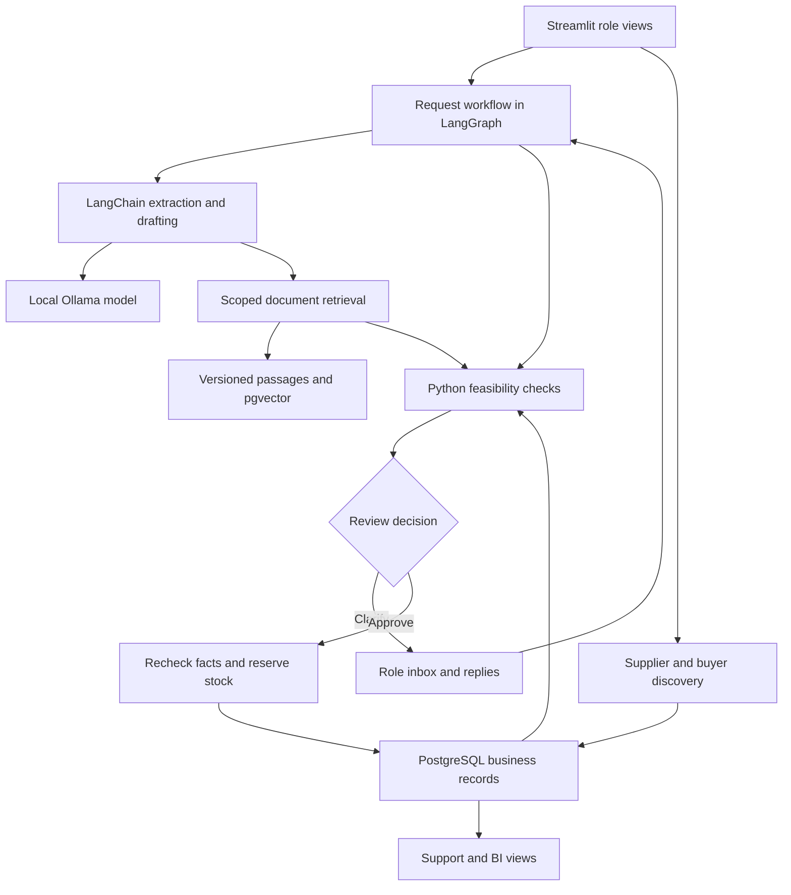

# Procure Pilot

A distributor needs to decide whether it can deliver 100 calibrated T20 loggers to Bhubaneswar by 5 pm IST on 27 November. The first build replays three dated decisions. Each result includes a verdict, source revisions and the person responsible for the next action.

## Run the first build

From this folder, using Python 3.10 or newer:

```sh
python3 -m procure_pilot demo
python3 -m procure_pilot demo --stage revised --json
python3 -m unittest discover -s tests -v
```

The default replay reads the fictional records in `data/demo.json`. Both this path and the PostgreSQL path call the same Python evaluator. The fixture makes the first exercise runnable without installing a service.

| Replay stage | Direct supplier A | Supplier B plus warehouse |
|---|---|---|
| Initial | Ask when all 100 arrive. A provided a dispatch date. | Ask sales about split delivery and procurement about arrival of 20 warehouse units. |
| Confirmed | Arrival still unknown. | Feasible for review. B covers 80 and the warehouse covers 20 under confirmed terms. |
| Revised | Arrival still unknown. | Infeasible under revised terms. B now expects 80 units to arrive after the customer deadline. |

**Try one change.** In a working copy of the fixture, move the arrival on QUOTE-B revision 2 to 27 November at 16:59 IST and replay the revised stage. The split should become feasible. Move it to 17:01 and it should become infeasible. The earlier stages still use revision 1.

## Use the PostgreSQL path

With a running PostgreSQL server, Python and permission to create a dedicated demo database, use the following commands. The example connection URI assumes local authentication. Set DATABASE_URL to your own local demo database if needed.

```sh
python3 -m venv .venv
source .venv/bin/activate
python -m pip install -r requirements.txt
createdb procure_pilot_demo
export DATABASE_URL='postgresql:///procure_pilot_demo'
python -m procure_pilot init-db
python -m procure_pilot demo --store postgres
PROCURE_TEST_POSTGRES=1 python -m unittest discover -s tests -v
```

Run createdb once. The initialization command creates the procure_pilot schema and inserts missing seed keys in one transaction. Repeated initialization preserves existing rows. Use a fresh demo database to load an edited fixture with the same keys. No database credentials belong in source control.

## Whole system architecture

Each box describes a responsibility inside one Python application or its PostgreSQL database. The CLI, schema, data readers, fixtures and decision rules are implemented in this build. The other boxes describe the next implementation stages.



| Boundary | Inputs | Outputs and responsibility |
|---|---|---|
| Discovery | Product, geography, supplier terms and buyer applications | Two evidence-backed lists with source URL, retrieval date and open qualification question. An analyst qualifies a lead before using it commercially. |
| ERP simulation | Order lines, quote revisions, available stock, allocations, shipments, receipts | PostgreSQL supplies facts as of the decision time. A quote revision can affect several customer lines. |
| Document intelligence | Datasheets, quote documents, policies, user identity and product model | Filter permitted document versions first. Retrieve with keyword search and compare with pgvector. LangChain and the local model return structured claims and passage references. |
| Decision | Required fields and candidate allocations with source references | Python checks mandatory constraints. Return feasible, needs confirmation or infeasible, with evidence and next owner. |
| Workflow | Request ID, decision revision, reviewer action or vendor reply | LangGraph checkpoints track where to resume. Business tables retain approvals. Recheck live terms and stock under a transaction before committing an approval. A unique action key makes retries safe. |
| Support and analytics | Approved commitments, shipment/receipt observations, status events and audiences | Role-scoped replies, time waiting on each owner and commitments at risk. Customer-reported counts stay distinguishable from warehouse receipts. |

## Step-by-step implementation

| Step | Build | Done when |
|---|---|---|
| 1. Seed one order and read its facts | **Implemented.** PostgreSQL schema and idempotent seed loader. A fixture reader supports a dependency-free replay. | At each simulated time, queries return the applicable supplier and warehouse revisions and the latest split decision. Live PostgreSQL parity requires a running server. |
| 2. Decide and explain | **Baseline implemented.** Evaluate two explicit allocations against model, unit, quantity, destination, certificate, quote validity, split consent and arrival cutoff. | The same 80+20 plan changes verdict across three stages. The revision names the 80 affected units. |
| 3. Add persistent human review | Build a manual review view first. Persist a versioned decision, named reviewer, reservations, action key and role-specific inbox event in one transaction. | Duplicate approval creates one message. Two concurrent requests cannot reserve the same units. A changed quote invalidates a pending approval. |
| 4. Add lead discovery | Build separate product-specific supplier and buyer query templates, public URL/CSV intake, evidence, qualification and deduplication. Begin with logger suppliers and cold-chain businesses. Repeat with shipping boxes. | Two supplier and two buyer leads each have a supporting passage and qualification question. Quotes use fictional companies. |
| 5. Add RAG and structured extraction | Ingest two similar-model datasheets, two fictional quotes and one policy. Preserve version, model, section and visibility. Extract matching fields using LangChain and a local model. Compare keyword and vector retrieval. | An exact-model question cites the correct passage. A missing certificate or commercial term produces a targeted question. |
| 6. Connect LangGraph and support | Wrap working functions in a resumable workflow. Add vendor replies, order-line dependencies, impact checks, shipments, receipts and human-reviewed messages. | Restart while waiting for approval. Change a supplier date. Reopen affected promises and route actions. Resolve a separate partial-delivery case. |
| 7. Evaluate and show the outcome | Add the at-risk queue and SQL metrics. Label 20 business cases, reserve five for final evaluation, record source accuracy, false promises and correctly identified feasible cases. | A fresh demo run is reproducible, includes a rejected promise and shows how a person corrects it. Publish only measured results. |

### What the current decision means

This first slice evaluates explicit candidates in a single-item, common-unit scenario. Warehouse availability is a dated seeded observation. The verdict covers the checks listed in step 2. Commercial budget, minimum order quantities, numeric product tolerances, inventory reservation and customer-facing approval belong in later increments. The terminal's feasible result is a recommendation for review. Replaying revisions demonstrates impact on the supplied candidates; an automatic notification after a real update requires step 6.

### Code reading order

1. Read the customer request, candidate legs and successive evidence in `data/demo.json`.
2. Read `procure_pilot/decision.py`. Follow a single leg from quantity through to arrival.
3. Compare the readers in `procure_pilot/store.py` with `sql/001_baseline.sql`. One PostgreSQL read transaction gives a consistent snapshot.
4. Use `procure_pilot/__main__.py` to replay the story and `tests/test_decision.py` to inspect the expected decisions.
5. Open `Procure-Pilot-Project-Plan.md` for the commercial use case, discovery sources, evaluation design and learning milestones.
